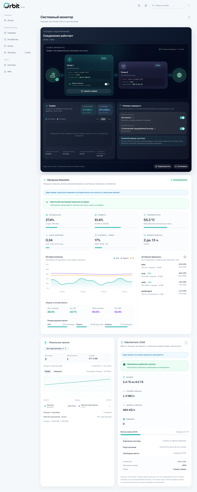
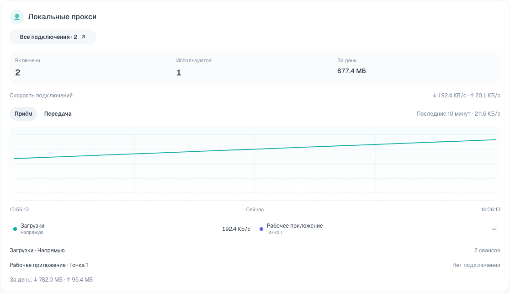
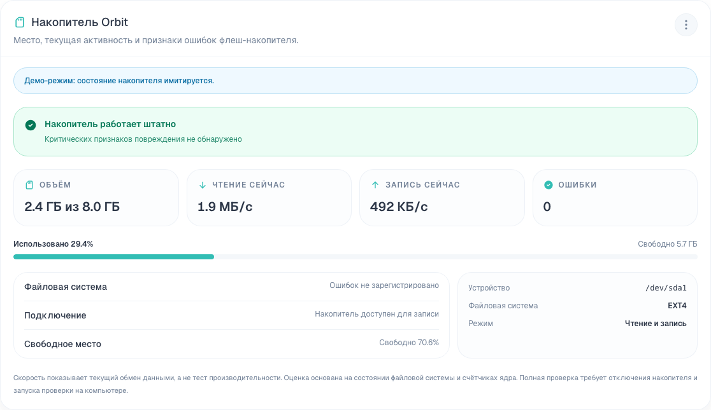
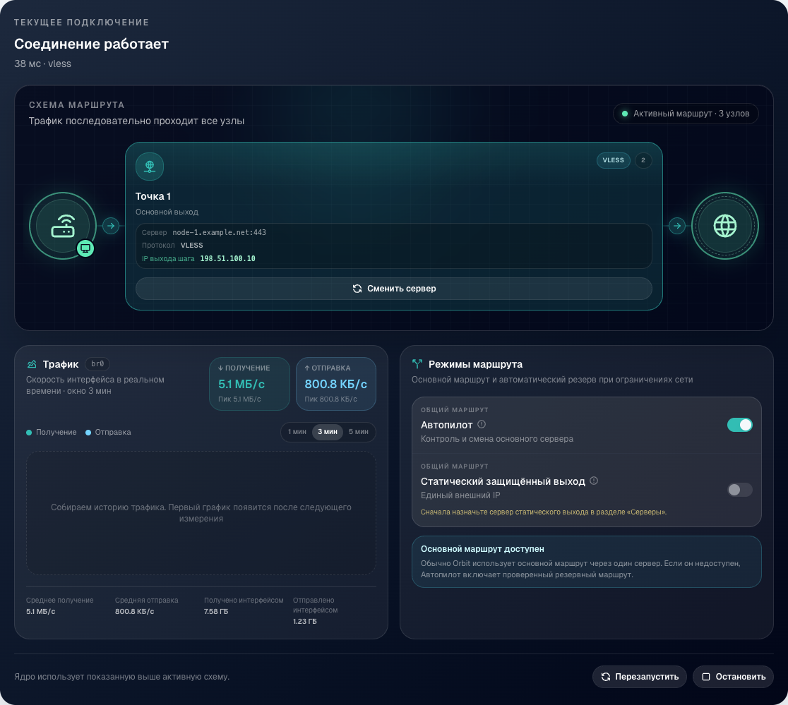
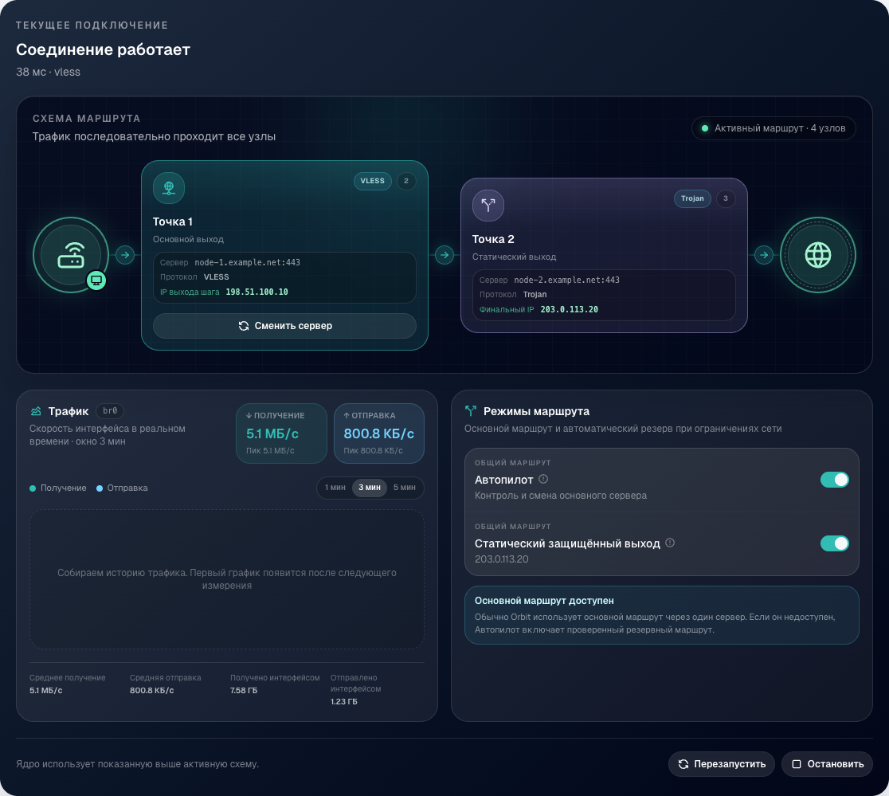
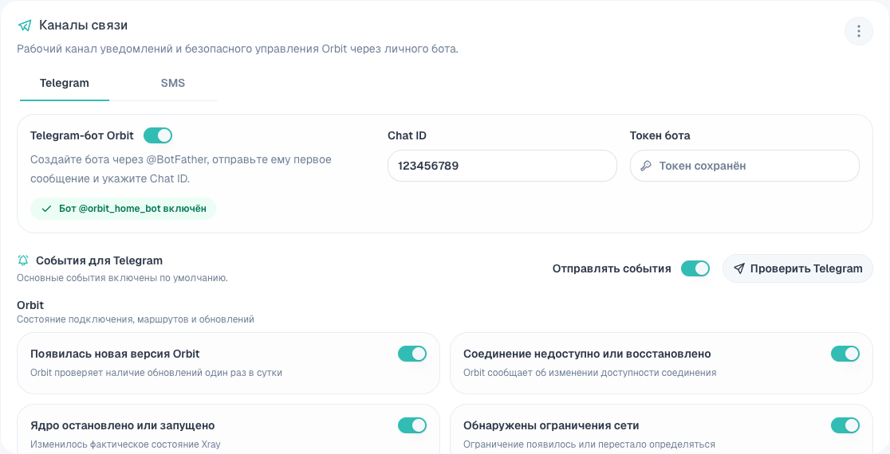

  

# Orbit

Orbit - панель управления подключениями на роутерах Keenetic с KeeneticOS 5 и
выше. Она помогает управлять Xray-core, серверами, маршрутами и устройствами
домашней или корпоративной сети из одного понятного интерфейса.

Orbit работает прямо на роутере. Не нужно настраивать каждое устройство
отдельно или устанавливать на него дополнительное приложение. Достаточно
выбрать нужные устройства и задать для них правила подключения.

## Зачем нужен Orbit

Orbit собирает управление сетью в одном месте. В панели видно, какие устройства
используют Orbit, через какой сервер проходит соединение и всё ли работает
сейчас. Если сервер перестал отвечать, Orbit поможет выбрать другой и проверить
новый маршрут до его применения.

Для домашней сети это простой способ управлять подключением телефонов,
компьютеров, телевизоров и других устройств через Keenetic. В корпоративной
сети Orbit помогает использовать одинаковые правила для рабочих мест и быстро
понимать, где возникла проблема.

## Основные возможности

### Серверы и источники

Добавляйте источники серверов, проверяйте задержку и доступность, выбирайте
основной сервер и настраивайте последовательные маршруты. Orbit поддерживает
популярные форматы Xray-core и показывает состояние каждого подключения.

### Устройства сети

Выбирайте устройства Keenetic, которым нужен Orbit. Для них можно закрепить
постоянный адрес, включить или временно отключить подключение и сразу увидеть
применённое правило.

### Правила маршрутизации

Создавайте правила для сайтов, доменов и IP-адресов. Правила можно объединять в
группы, включать целиком и дополнять понятными комментариями. Поддерживаются
базы GeoIP и GeoSite.

### Локальные подключения

Orbit может создать отдельное SOCKS5-подключение для приложения или устройства.
На главном экране видно, используется ли оно и сколько данных через него прошло.

### Контроль состояния

Панель показывает внешний адрес, состояние Xray-core, текущий маршрут и сетевую
активность. Автопилот следит за доступностью соединения и помогает перейти на
рабочий сервер при сбое.

### Быстрый доступ

Orbit создаёт локальный адрес `orbit.home` и добавляет кнопку в интерфейс
Keenetic. Панель открывается одним нажатием без поиска IP-адреса и порта.

### Обновление и перенос

Обновление устанавливается из панели или из подписанного файла. Перед запуском
Orbit проверяет пакет и сохраняет рабочую версию для автоматического отката.
Настройки можно перенести на другой накопитель через встроенный мастер.

## Главный экран

На главном экране собраны текущее подключение, нагрузка Keenetic, локальные
прокси и состояние накопителя. Шапка, основное меню и быстрые действия всегда
остаются под рукой.

### Нагрузка Keenetic

Сразу под текущим подключением находится нагрузка Keenetic. Плитка показывает
процессор, память, температуру, накопитель, время работы и активные процессы
Orbit. График помогает заметить необычный рост нагрузки.

### Локальные прокси

Отдельная плитка показывает локальные SOCKS5, активные подключения, скорость и
объём данных. Каждый SOCKS5 можно назначить отдельной программе.

#### Пример с Torrent

1. Создайте локальный прокси «Загрузки» и выберите прямой выход.
2. Разрешите подключение устройству, на котором работает Torrent-клиент.
3. Скопируйте из Orbit адрес и порт SOCKS5.
4. Выберите SOCKS5 в сетевых настройках Torrent-клиента и вставьте адрес с
   портом. Если клиент умеет отдельно настраивать соединения с участниками и
   разрешение имён, также направьте их через этот SOCKS5.
5. Запустите загрузку и проверьте скорость и объём данных на плитке «Локальные
   прокси».

Остальные программы и устройства продолжат использовать свои маршруты Orbit.

### Накопитель Orbit

Отдельная плитка показывает свободное место, скорость чтения и записи, ошибки
файловой системы и готовность накопителя. Из её меню можно открыть диагностику
или перенести настройки Orbit.

На изображениях используются тестовые адреса и показатели.

## Обычное подключение

Вы выбираете устройства и основной выход. Orbit применяет маршрут на Keenetic,
следит за его состоянием и показывает результат в панели.

## Последовательный маршрут

Если нужен постоянный внешний адрес, Orbit использует основной и статический
выходы. Основной выход можно менять, а статический сохраняет один внешний
адрес. Перед применением Orbit проверяет весь маршрут.

## Правила для разных задач

Не весь трафик обязан идти одинаково. Orbit может направить выбранные сайты
через сервер, оставить прямое подключение или выделить отдельный локальный
SOCKS5 для программы. Правила объединяются в группы и включаются вместе.

## Управление через Telegram и SMS

Orbit может отправлять владельцу уведомления и принимать разрешённые команды
через личного Telegram-бота. Если к Keenetic подключён совместимый модем, можно
дополнительно использовать SMS. Каждый канал включается отдельно и принимает
команды только от доверенного владельца.

## Установка

Пошаговая инструкция находится в [INSTALL.md](INSTALL.md).

Для новой установки скачайте из последнего релиза файл
`orbit-opkg-mipsel-vX.Y.Z.tar.gz`. Положите архив без распаковки в каталог
`install` на EXT4-разделе OPKG и выберите этот раздел в настройках OPKG
KeeneticOS.

После завершения Orbit добавит кнопку в интерфейс Keenetic. Панель также можно
открыть по адресу `http://orbit.home`. Если локальное имя ещё не появилось,
используйте резервный адрес `http://<IP роутера>:3000`.

## Обновление

Orbit проверяет подписанные обновления в этом репозитории. Новую версию можно
установить из панели или импортировать из файла `.orbit-update`.

## Что понадобится

Orbit предназначен для KeeneticOS 5 и выше. На роутере должны быть установлены
OPKG, поддержка EXT4 и компоненты Netfilter для прозрачной маршрутизации.

Первый готовый установщик предназначен для MIPS little-endian. Поддерживаемая
архитектура указана в названии файла релиза.

## Безопасность

Скачивайте Orbit только из раздела Releases этого репозитория. Перед применением
обновления Orbit проверяет цифровую подпись пакета.
